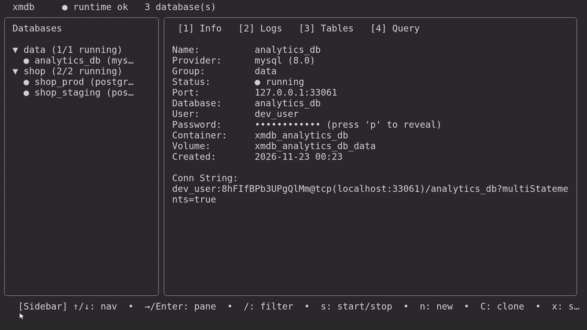

# xmdb: Database Management CLI

A CLI for managing throwaway development databases as Docker containers.
Supports MySQL and PostgreSQL with a single consistent interface.

```
xmdb create mydb --provider postgres   # container + volume + ready in seconds
xmdb connect mydb                      # connection string when you need it
xmdb remove mydb                       # everything gone, volumes included
```

## Demo



*Direct captures of the terminal UI: connection card with password reveal,
live ER diagram and table list, inline SQL with results and CSV/JSON export,
one-keypress clone, and start/stop — running against the bundled seeds in
[examples/seed](examples/seed).*

## Why

Spinning up a database for local development means remembering image names,
port mappings, environment variables, volume flags, and the right `docker run`
incantation for each engine. xmdb does it in one command and keeps track of what
it created: containers, named volumes, ports, and credentials live in
`~/.xmdb/databases/<name>.json`, so `xmdb` commands work by name instead of
container ID.

## Features

- **Interactive TUI dashboard**: run `xmdb` with no arguments for a split-pane
  terminal dashboard with collapsible groups, live status, Info/Logs/Tables/Query
  tabs, and inline modals for creating, backing up, restoring, resetting, and
  removing databases.
- **One-command create**: pulls the image, creates a named volume, starts the
  container, waits for real protocol-level readiness, and provisions a dev user.
  Run `xmdb create` with no arguments for the guided modal/wizard, or pass flags
  for automation. Passwords are generated with `crypto/rand`.
- **MySQL and PostgreSQL**: provider abstraction handles engine differences
  (images, ports, env vars, user grants, connection strings).
- **Lifecycle by name or group**: `start`, `stop`, `remove`, `reset`, `logs`,
  `status`. Start or stop an entire group at once with `-g <group|global>`.
- **Groups**: organize databases per project or organization. A database is
  `global` by default; assign one at creation with `-g work`, then filter
  views with `xmdb list -g work`.
- **SQL access & interactive shell**: `xmdb shell <name>` drops straight into
  `psql` or `mysql` inside the container. `xmdb exec --sql "..."` runs queries
  with table or `--json` output, `xmdb exec --file <script>` streams
  multi-statement scripts, and `xmdb table list` / `xmdb table describe` inspect
  schemas.
- **Backup, restore, and reset**: `mysqldump`/`pg_dump` runs inside the
  container and streams the dump straight to a local file; restore streams the
  file back through stdin. `xmdb reset <name>` wipes all data and re-initializes
  the database with the same port and credentials.
- **Scriptable output & clipboard**: `--json` output on `list`, `status`,
  `info`, and `exec`; `xmdb connect <name> [--format string|json|env] [-c|--copy]`
  copies the connection string to your clipboard.

## Installation

Requires a Docker-compatible daemon (Docker, Podman with the `docker` alias,
etc.).

### One-liner (curl)

```sh
curl -fsSL https://raw.githubusercontent.com/iqbalmu/xmdb/main/install.sh | sh
```

Detects your OS/arch, downloads the matching release binary, verifies its
sha256 checksum, and installs it. Defaults to `/usr/local/bin` (falls back to
`~/.local/bin` without sudo access); both are overridable:

```sh
XMDB_INSTALL_DIR=~/.local/bin VERSION=v1.5.0 sh install.sh
```

Re-running the installer (or running `xmdb update`) upgrades to the latest release.

### Prebuilt binaries

Grab a binary for your platform from
[GitHub Releases](https://github.com/iqbalmu/xmdb/releases), unpack it, and put
`xmdb` somewhere in your `PATH`:

```sh
tar -xzf xmdb_*_linux_amd64.tar.gz
sudo install ./xmdb /usr/local/bin/
```

### go install

```sh
go install github.com/iqbalmu/xmdb/cmd/xmdb@latest
```

The binary lands in `$(go env GOPATH)/bin` (usually `~/go/bin`), so make sure
that directory is on your `PATH`.

### From source

Requires Go 1.25+:

```sh
git clone https://github.com/iqbalmu/xmdb
cd xmdb
make install          # builds and copies to /usr/local/bin
```

Or without make:

```sh
go build -o xmdb ./cmd/xmdb && sudo mv xmdb /usr/local/bin/
```

## Quick start

```sh
# Launch the interactive TUI dashboard
xmdb

# Guided database creation
xmdb create

# Scripted: postgres on a custom port in a group, optionally seeded
xmdb create appdb --provider postgres --port 55432 -g work
xmdb create appdb --provider postgres --seed ./migrations

# Or start from the bundled example data (see examples/seed):
xmdb create shopdb --provider postgres --seed examples/seed/ecommerce
xmdb create analytics --provider mysql --seed examples/seed/analytics

# Clone an existing database (schema + data) into a new instance
xmdb clone appdb appdb_staging

# Grab credentials / connection string
xmdb connect appdb
xmdb connect appdb --copy             # copy connection string to clipboard
xmdb connect appdb --format env       # DB_HOST=... DB_PORT=... for .env files
xmdb connect appdb --format json      # for scripts

# Inspect, shell, and query
xmdb shell appdb                      # interactive psql / mysql shell
xmdb table list appdb
xmdb table describe appdb users
xmdb exec appdb --sql "SELECT version();"
xmdb exec appdb --sql "SELECT * FROM users;" --json

# Backup, restore, reset, and group lifecycle
xmdb backup appdb -o ./dump.sql
xmdb restore appdb ./dump.sql
xmdb reset appdb                      # wipe data, keep port & credentials
xmdb stop -g work                     # stop all databases in group 'work'
xmdb start -g work                    # start all databases in group 'work'
```

## TUI Dashboard

Running `xmdb` without arguments opens the terminal dashboard:

- **Left pane**: databases grouped by group name (collapsible with `Enter`/`Space`),
  live running status, and `/` filter.
- **Right pane**: four tabs (`1`-`4`, `[`/`]`, or `Tab`):
  - `1` **Info**: container status, host/port, credentials (`p` toggles password
    visibility, `c` copies connection string).
  - `2` **Logs**: live container logs (`f` toggles auto-follow, `/` searches
    logs, `n`/`N` jumps between matches).
  - `3` **Tables**: browse tables in an interactive 2D ERD diagram (default) or
    list view (`v` toggles diagram/list, `f` toggles fields, `/` filters tables,
    `+`/`-`/`0` zooms, `Shift+arrows` pans, `Enter` inspects schema and rows,
    `Q` jumps to Query tab with `SELECT * FROM <table> LIMIT 50;`).
  - `4` **Query**: press `i` or `Enter` to write and execute SQL inline
    (`↑`/`↓` browses persistent query history, `e` exports results to CSV/JSON,
    `c` copies results as JSON).
- **Actions**: `s` start/stop database or group, `n` create database, `C` clone
  database, `x` open SQL shell, `b` backup, `L` restore, `R` reset, `d` remove,
  `r` refresh, `?` show all shortcuts, `q` quit.

## Commands

| Command | Description |
|---|---|
| `xmdb` | Launch the interactive TUI dashboard |
| `xmdb create [name] [-p provider] [-v version] [--port N] [-g group] [--seed path] [-i] [--volume=true]` | Create a database (interactive when no name given); `--seed` runs a `.sql` file or directory of `*.sql` files |
| `xmdb clone <source> <target> [--port N] [-g group] [-v version]` | Clone a managed database and its data into a new instance |
| `xmdb list [-g group\|global] [--json]` | List all managed databases, optionally filtered by group (aliases: `ls`) |
| `xmdb status [-g group\|global] [--json]` | Live status of all containers, optionally filtered by group |
| `xmdb start [name] [-g group\|global]` | Start a stopped database, or all databases in a group |
| `xmdb stop [name] [-g group\|global]` | Stop a running database, or all databases in a group |
| `xmdb remove <name> [-f] [--keep-data]` | Remove container and data volume (`--keep-data` keeps the volume; aliases: `rm`, `delete`) |
| `xmdb reset <name> [-f]` | Wipe all data and re-initialize with the same port and credentials |
| `xmdb info <name> [--json]` | Detailed database information |
| `xmdb connect <name> [--format string\|json\|env] [-c\|--copy]` | Show connection information (and optionally copy to clipboard) |
| `xmdb shell <name>` | Open an interactive SQL shell (`psql`/`mysql`) inside the container (aliases: `sh`, `console`) |
| `xmdb exec <name> --sql "..." / --file f.sql [--json]` | Execute SQL with table or JSON output |
| `xmdb logs <name> [-n N] [-f]` | Container logs |
| `xmdb backup <name> [-o file]` | Dump the database to a local `.sql` file |
| `xmdb restore <name> <file> [-f]` | Restore from a `.sql` file (prompts before overwriting) |
| `xmdb table list <name>` / `xmdb table describe <name> <table>` | Inspect tables |
| `xmdb provider list` | Show supported providers and defaults |
| `xmdb doctor [--fix] [-f] [--json]` | Check container runtime, orphan resources, stale states, and port conflicts |
| `xmdb config init/show/path` | Manage `~/.xmdb/config.yaml` |
| `xmdb update` | Update `xmdb` to the latest release |
| `xmdb version` | Version information |

## Design notes

- Works with Docker and Podman: on every connect `xmdb` probes candidate
  daemons in order (`$DOCKER_HOST`, `/var/run/docker.sock`, then the rootless
  and rootful Podman sockets; on Windows, the Docker Desktop and podman named
  pipes). The first one that answers wins; pin a side with
  `--runtime docker|podman`.
- State: one JSON file per database in `~/.xmdb/databases/`, written with
  `0600` permissions (credentials included).
- Ports bind to `127.0.0.1` only, so your dev database is not reachable from
  the network. Create refuses ports already used by another managed database or
  any local process.
- Named volumes (`xmdb_<name>_data`) survive container restarts; `xmdb remove`
  deletes them unless `--keep-data` is passed. Creating a database when a
  volume with that name still exists fails fast with instructions, because
  container images skip init on an existing volume (new credentials would not
  apply).
- Readiness: `xmdb create` waits until the server completes a real protocol
  handshake before provisioning users (no fixed sleeps), so it works on slow
  machines and rootless container runtimes alike.
- User provisioning: the dev user (`dev_user`) gets full privileges on its
  database. On PostgreSQL 15+ the user is made database owner, which restores
  `CREATE` on schema `public` (revoked for non-owners since PG15).
- SQL identifiers and literals supplied by users are escaped before being
  interpolated into DDL.

## Development

```sh
make build    # build to bin/
make test     # go test ./...
make fmt      # go fmt
go vet ./...
```

### Releasing

Releases are cut by pushing a semver tag; GitHub Actions builds binaries for
linux/darwin/windows (amd64 + arm64) and publishes them to GitHub Releases.

```sh
git tag -a v1.0.1 -m "v1.0.1"
git push origin v1.0.1
```

Test a release build locally without uploading:

```sh
make release-snapshot
```

## License

[MIT](LICENSE)
